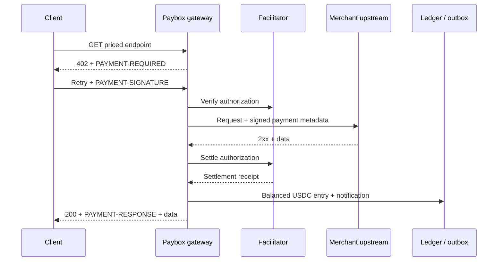

# Paybox Payments

A payment operations service for Nigerian commerce platforms. Paystack test payments, immutable double-entry accounting, durable merchant notifications, reconciliation, and x402 paid API endpoints. Built by Obaro Destiny Udurie.

## Get paid by automated clients (x402)

Price an endpoint in **Paid endpoints** on the dashboard. A client receives an HTTP 402 challenge, signs a test-USDC payment authorization, and retries. Paybox verifies the authorization, calls the merchant upstream, settles after a successful response, and records the payment in a separate USDC book.



`X402_MODE=fake` uses real signatures and offline simulated settlement. `X402_MODE=testnet` uses the public facilitator on Base Sepolia; no other network is accepted. Testnet transactions link to the explorer. Fake receipts are labelled simulated. NGN and USDC balances are never combined.

The gateway consumes each authorization once, including under concurrent requests. Upstream failure does not settle. Settlement failure does not credit. Confirmed receipts survive a ledger-posting failure through the outbox. See [the x402 decision record](docs/adr/x402-gateway.md) for the settlement boundary and recovery limitations.

## Local development

Node 22 or later, pnpm 10, and Docker are required.

```sh
pnpm install
docker compose up -d postgres
pnpm db:migrate
DEMO_MODE=true pnpm --filter api dev
# Separate terminals:
DEMO_MODE=true pnpm worker
pnpm --filter @paybox/web dev
node examples/merchant-receiver/server.mjs
pnpm demo:seed
pnpm demo
```

Open http://localhost:3000. Generated local login credentials and the merchant API key are in `.local/demo.json` (ignored by Git). The seed creates `demo-store`, sample NGN payments, and `/x402/m/demo-store/v1/stock` priced at 0.01 test USDC. `pnpm demo` currently runs the x402 challenge/payment/replay step. The complete operations walkthrough follows in the demo milestone.

For the real facilitator, configure a route with your Base Sepolia recipient, an HTTPS upstream that validates the signed header, and `X402_MODE=testnet`. Provide a throwaway `X402_DEMO_PRIVATE_KEY` through the environment, fund it with test USDC, and set `X402_DEMO_PATH` to the route. No private key is written to disk. Mainnet is rejected.

API documentation: http://localhost:4000/v1/openapi.json.

```sh
pnpm lint
pnpm typecheck
pnpm test
docker compose -f compose.test.yaml up -d
pnpm test:integration
pnpm build
pnpm test:e2e
```

MIT · Copyright Obaro Destiny Udurie.
