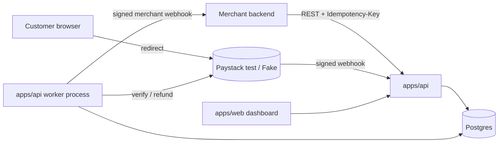
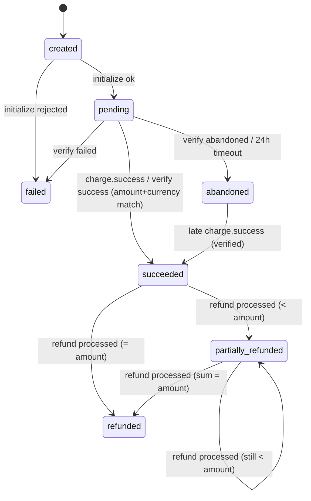
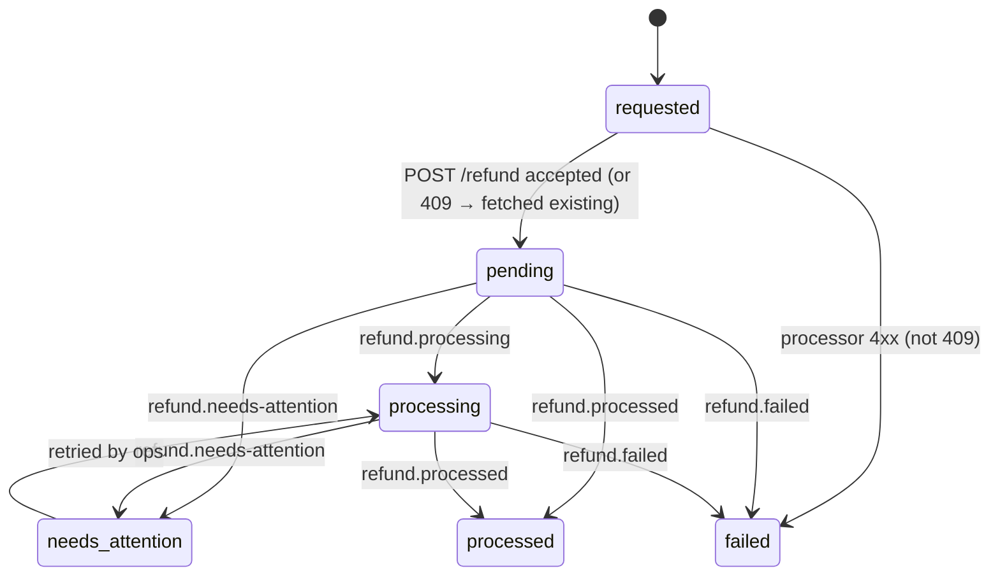
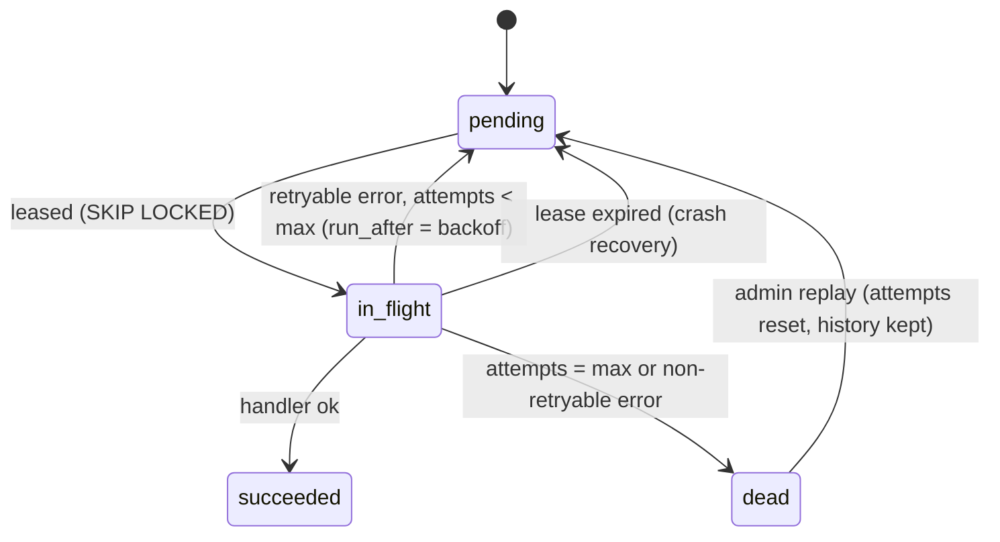

# Paybox Payments — Product & Engineering Spec

Status: build spec v1 · Owner: Obaro Destiny Udurie · Mode: **Paystack TEST MODE only**

If groundwork already exists in the repo, conform it to this spec. Where this spec and earlier notes disagree, this spec wins.

---

## 1. Product story

**Paybox** is the payments layer a Nigerian SME commerce platform puts between its merchants (a Lagos fashion store, an Abuja pharmacy, an Ibadan event organiser) and Paystack. Merchants call one clean API to take payment, get one signed webhook when money actually moved, and see every naira on a ledger that always balances.

The problems it solves are the ones that cost real Nigerian merchants money:

- **A double tap on "Pay" on a flaky 3G network** must not create two charges. That's handled by idempotency keys.
- **Paystack retries webhooks.** A replayed `charge.success` must not credit the merchant twice. That's handled by event dedupe.
- **The merchant's own server is down.** Notifications must survive, retry and be replayable. That's handled by the outbox, backoff and DLQ.
- **A webhook never arrives, or the numbers don't agree.** A nightly reconciliation must catch it before finance does.
- **Partial refunds** must never exceed what was paid, even under concurrent clicks.
- **Selling an API to software, not people.** Automated clients and scripts can't click through a checkout page. Paybox lets a merchant price any API endpoint and get paid per request over **x402** (HTTP 402 Payment Required), with every payment on the same ledger as card payments. This is a headline feature (section 18).

**Target users**

| User                          | Needs                                                                    |
| ----------------------------- | ------------------------------------------------------------------------ |
| Merchant developer            | Simple REST API, test keys, OpenAPI, predictable errors, signed webhooks |
| Ops / finance at the platform | Dashboard with payment timelines, DLQ replay and a reconciliation report |
| Hiring reviewer (implicit)    | A 2-minute demo that proves the hard parts work                          |

## 2. Two-minute demo script

Run `docker compose up` with `PAYSTACK_MODE=fake`, then `pnpm demo:seed`. The fake processor makes the demo deterministic and offline. The same script works against real Paystack test mode, except step 5, which needs the fake's drift control.

| t    | Action                                                                                                                                                                                                            | What the viewer sees                                                                                                                                                                                            |
| ---- | ----------------------------------------------------------------------------------------------------------------------------------------------------------------------------------------------------------------- | --------------------------------------------------------------------------------------------------------------------------------------------------------------------------------------------------------------- |
| 0:00 | Dashboard home                                                                                                                                                                                                    | KPIs: volume today (₦), success rate, DLQ depth 0, last recon run green                                                                                                                                         |
| 0:15 | `scripts/demo/01-create.sh` sends `POST /v1/payments` with `Idempotency-Key: demo-1` **twice**, then a third time with a different amount                                                                         | 201, then 201 with `Idempotent-Replayed: true` and the same payment id, then **409 `idempotency_key_reuse`**. One row in the dashboard.                                                                         |
| 0:35 | Open `authorization_url` and pay with test card `4084 0840 8408 4081` (fake checkout: "Succeed")                                                                                                                  | Timeline: `created → pending → succeeded`. Ledger entry posted and balanced.                                                                                                                                    |
| 0:50 | `02-replay-webhook.sh` re-sends the same signed `charge.success` 3 times                                                                                                                                          | Webhook log shows 1 `processed` and 3 `duplicate`. Merchant balance unchanged.                                                                                                                                  |
| 1:05 | Toggle the merchant's webhook receiver to "return 500" (`03-break-merchant.sh`) and make a second payment                                                                                                         | Outbox job attempts 1→8 with growing backoff (demo uses a compressed schedule), then **DEAD**. DLQ badge = 1.                                                                                                   |
| 1:25 | Fix the receiver, click **Replay** in DLQ                                                                                                                                                                         | Job → `succeeded`. The attempt history is kept. An audit log entry names who replayed it.                                                                                                                       |
| 1:35 | `04-drift.sh` makes the fake report a different amount for payment #2, then run reconciliation                                                                                                                    | Report: **1 mismatch `amount_mismatch` (local ₦15,000 vs processor ₦14,500)**, flagged and not auto-fixed.                                                                                                      |
| 1:50 | Partial refund of ₦5,000, then try to refund ₦20,000                                                                                                                                                              | Refund `pending → processed`. Second refund **422 `refund_exceeds_refundable`**.                                                                                                                                |
| 2:05 | `05-agent-pays.sh`: a script acting as an automated client calls the merchant's priced endpoint `GET /x402/m/demo-store/v1/stock` with no payment, reads the 402, pays and retries; then replays the same payment | First call **402** with a `PAYMENT-REQUIRED` challenge. Second call **200** with data and a `PAYMENT-RESPONSE` receipt. Replay is rejected. Dashboard x402 tab shows the payment and the balanced ledger entry. |

## 3. Scope and non-goals

**In scope:** one-off card/bank/transfer payments via Paystack Standard (redirect checkout), verify, webhooks, refunds (full and partial), merchant-facing outbound webhooks, idempotency, outbox worker, DLQ and replay, a double-entry ledger, reconciliation, a dashboard, a Paystack fake, tests, CI, OpenAPI and docker compose. Single currency **NGN**, with amounts in **kobo integers** everywhere.

**Also in scope:** x402 paid endpoints (section 18), testnet only.

**Non-goals:** live mode or real money (x402 runs on testnet only); payouts/transfers; subscriptions and plans; split payments and subaccounts; card vaulting or charge-authorization; disputes (events are stored but not acted on); multi-currency and FX; PCI scope (cards never touch Paybox, since checkout is Paystack-hosted); KYC; mobile apps.

## 4. Architecture



- **Monorepo (pnpm):** `apps/api` (Fastify, chosen for its raw-body control and schema-first OpenAPI), `apps/web` (Next.js App Router), `packages/db` (Drizzle + SQL migrations), `packages/shared` (Zod schemas, money helpers, state machines as pure functions, error codes).
- **Worker:** same codebase, `pnpm --filter api worker`. A separate container in compose. It leases jobs with `SELECT … FOR UPDATE SKIP LOCKED`.
- **`PaystackClient` interface:** `initialize`, `verify`, `createRefund`, `fetchRefundByReference`. It has two implementations, `HttpPaystackClient` and `FakePaystackClient` (in-process state plus a tiny `/fake/*` HTTP surface for checkout and fault injection). It's selected by `PAYSTACK_MODE=fake|test`. **Refuse to boot** if the secret key starts with `sk_live_`.

## 5. Paystack integration facts (verified against current docs, see Appendix)

| Concern                     | Rule                                                                                                                                                                                                                                                                                                                            |
| --------------------------- | ------------------------------------------------------------------------------------------------------------------------------------------------------------------------------------------------------------------------------------------------------------------------------------------------------------------------------- |
| Initialize                  | `POST https://api.paystack.co/transaction/initialize`, body `email`, `amount` (subunit), `reference` (only `-`, `.`, `=` and alphanumerics), `currency`, `callback_url`, `metadata` (stringified JSON), `channels`. Response `data.authorization_url`, `data.access_code`, `data.reference`.                                    |
| Verify                      | `GET /transaction/verify/:reference`. Use `data.status`, `data.amount`, `data.currency`, `data.fees`, `data.paid_at`, `data.channel`, `data.gateway_response`. Store `data.id` as **bigint** (Paystack says to treat it as unsigned 64-bit).                                                                                    |
| Webhook signature (current) | Header `Paystack-Signature: t=<unix>,v1=<whk_kid>:<hex>[,v1=…]`. Compute HMAC-SHA512 of `` `${t}.` + rawBody `` with the full `whsec_…` signing secret. Constant-time compare against **every** `v1`. Reject if \|now−t\| > 300 s. Return 401 if none match. Support multiple secrets for rotation.                             |
| Webhook signature (legacy)  | `x-paystack-signature` = HMAC-SHA512 of raw body using the **secret key**, with no timestamp. Accept it only when `PAYSTACK_ACCEPT_LEGACY_SIGNATURE=true` and no `Paystack-Signature` header is present.                                                                                                                        |
| Webhook delivery            | Respond **200 fast** (Paystack expects a response within 5 s). Test mode retries hourly for 10 hours. Optionally allow-list source IPs `52.31.139.75`, `52.49.173.169`, `52.214.14.220` (config flag, off locally).                                                                                                             |
| Events used                 | `charge.success`, `refund.pending`, `refund.processing`, `refund.needs-attention`, `refund.failed`, `refund.processed`. Others are stored as `ignored`.                                                                                                                                                                         |
| Refund create               | `POST /refund`, body `transaction` (reference or id), `amount` (optional, means full), `currency`, `customer_note`, `merchant_note`, `reference` (8–64 chars `[A-Za-z0-9_-]`, case-insensitive unique). A reused reference returns **409**, meaning "fetch the existing refund via `GET /refund?reference=`" and not a failure. |
| Refund statuses             | `pending`, `processing`, `needs-attention`, `failed`, `processed`.                                                                                                                                                                                                                                                              |
| Test cards                  | Success `4084 0840 8408 4081` (CVV 408). Declined `4084 0800 0000 5408` (CVV 001). Insufficient funds `4084 0800 0067 0037` (CVV 787). Refund-fails `4084 0800 0067 1803` (CVV 180). Any future expiry.                                                                                                                         |

**Webhook dedupe key.** Paystack payloads are `{ event, data }` with **no top-level event id**. Paybox derives `event_key = sha256(event + ":" + (data.id ?? data.reference ?? data.refund_reference) + ":" + data.status)`. It also stores `body_sha256`. `UNIQUE(event_key)` is the idempotency guarantee. A byte-identical redelivery and a re-serialised redelivery of the same state change both dedupe.

## 6. Data model (Postgres 16, Drizzle)

All money is `bigint` kobo with `CHECK (amount > 0)`. All ids are `uuid` (v7) unless noted. Every table has `created_at timestamptz not null default now()`.

| Table                  | Key columns                                                                                                                                                                                                                                       | Constraints and indexes                                                                                                                     |
| ---------------------- | ------------------------------------------------------------------------------------------------------------------------------------------------------------------------------------------------------------------------------------------------- | ------------------------------------------------------------------------------------------------------------------------------------------- |
| `merchants`            | id, name, webhook_url, webhook_secret_enc                                                                                                                                                                                                         |                                                                                                                                             |
| `api_keys`             | id, merchant_id, prefix (`pbx_test_sk_xxxx`), key_hash (sha256), revoked_at                                                                                                                                                                       | UNIQUE(prefix)                                                                                                                              |
| `dashboard_users`      | id, email, password_hash (argon2id), role `admin\|ops\|viewer`                                                                                                                                                                                    | UNIQUE(lower(email))                                                                                                                        |
| `payments`             | id, merchant_id, reference (text), amount, currency `char(3)`, status, customer_email, paystack_id bigint null, access_code, authorization_url, channel, fees bigint null, paid_at, metadata jsonb, refunded_amount bigint default 0, version int | **UNIQUE(reference)**, UNIQUE(paystack_id), CHECK(refunded_amount ≤ amount), INDEX(merchant_id, created_at desc), INDEX(status, created_at) |
| `payment_events`       | id, payment_id, type, from_status, to_status, source `api\|webhook\|worker\|recon\|admin`, detail jsonb, correlation_id                                                                                                                           | INDEX(payment_id, created_at). Append-only (trigger rejects UPDATE/DELETE).                                                                 |
| `refunds`              | id, payment_id, reference (`rf_` + 20 chars), amount, status, paystack_refund_id bigint null, reason, requested_by                                                                                                                                | **UNIQUE(lower(reference))**, INDEX(payment_id)                                                                                             |
| `idempotency_keys`     | merchant_id, key, method, path, request_hash, state `in_progress\|completed`, response_status, response_body jsonb, locked_until, expires_at                                                                                                      | **PK(merchant_id, key)**, INDEX(expires_at)                                                                                                 |
| `webhook_events`       | id, provider `paystack`, event_key, event_type, body_sha256, raw_body bytea, signature_kid, received_at, status `received\|processed\|duplicate\|ignored\|failed`, payment_id null, refund_id null                                                | **UNIQUE(event_key)**, INDEX(received_at desc)                                                                                              |
| `outbox_jobs`          | id, type, aggregate_id, payload jsonb, status, attempts int, max_attempts int, run_after, leased_until, lease_owner, last_error, dedupe_key                                                                                                       | **UNIQUE(dedupe_key)**, INDEX(status, run_after) WHERE status IN ('pending','in_flight')                                                    |
| `job_attempts`         | id, job_id, attempt_no, started_at, finished_at, outcome, http_status, error                                                                                                                                                                      | UNIQUE(job_id, attempt_no)                                                                                                                  |
| `ledger_accounts`      | id, code, type `asset\|liability\|revenue\|expense`, merchant_id null, currency                                                                                                                                                                   | UNIQUE(code, merchant_id)                                                                                                                   |
| `journal_entries`      | id, kind, payment_id null, refund_id null, idempotency_ref, posted_at, memo                                                                                                                                                                       | **UNIQUE(idempotency_ref)** so the same posting can never be booked twice                                                                   |
| `ledger_lines`         | id, entry_id, account_id, direction `debit\|credit`, amount                                                                                                                                                                                       | CHECK(amount > 0). A deferred constraint trigger checks Σdebit = Σcredit per entry. Append-only.                                            |
| `reconciliation_runs`  | id, started_at, finished_at, window_from, window_to, checked, matched, mismatched, status                                                                                                                                                         |                                                                                                                                             |
| `reconciliation_items` | id, run_id, payment_id, kind, local jsonb, remote jsonb, resolution `open\|auto_healed\|resolved\|ignored`, resolved_by, note                                                                                                                     | UNIQUE(run_id, payment_id, kind)                                                                                                            |
| `audit_log`            | id, actor, action, target_type, target_id, detail jsonb, ip                                                                                                                                                                                       | Append-only                                                                                                                                 |

Job `dedupe_key` examples: `process_webhook:{webhook_event_id}`, `notify_merchant:{payment_id}:{event}`, `create_refund:{refund_id}`.

## 7. API contract

Base `/v1`. Auth is `Authorization: Bearer pbx_test_sk_…` (merchant API) or a session cookie (dashboard routes under `/v1/admin`). JSON only. Amounts are integers in kobo. Every response carries `X-Request-Id`.

**Error format (RFC 9457, `application/problem+json`):**

```json
{
  "type": "https://paybox.dev/errors/idempotency_key_reuse",
  "title": "Idempotency key reused with a different request",
  "status": 409,
  "code": "idempotency_key_reuse",
  "detail": "Key 'demo-1' was first used with a different body.",
  "request_id": "req_01J…"
}
```

| Method & path                                                                        | Notes                                                                                                                                                                                      | Success                                                                                                                      | Errors                                                                                                                                                          |
| ------------------------------------------------------------------------------------ | ------------------------------------------------------------------------------------------------------------------------------------------------------------------------------------------ | ---------------------------------------------------------------------------------------------------------------------------- | --------------------------------------------------------------------------------------------------------------------------------------------------------------- |
| `POST /v1/payments`                                                                  | **Idempotency-Key required.** Body `{ "amount": 1500000, "currency": "NGN", "customer": { "email": "ada@example.com" }, "reference?": "ORD-1042", "callback_url?": "…", "metadata?": {} }` | **201** `{ "id", "reference", "status": "pending", "amount", "currency", "authorization_url", "access_code", "created_at" }` | 400 `validation_error`, 401, 409 `idempotency_key_reuse`, 409 `idempotency_in_progress` (+`Retry-After: 1`), 409 `reference_taken`, 502 `processor_unavailable` |
| `GET /v1/payments`                                                                   | `?status=&from=&to=&q=&page_token=&limit≤100`                                                                                                                                              | 200 `{ "data": [...], "next_page_token" }`                                                                                   | 400                                                                                                                                                             |
| `GET /v1/payments/:id`                                                               | Includes `timeline[]`, `refunds[]`, `ledger_entries[]`                                                                                                                                     | 200                                                                                                                          | 404                                                                                                                                                             |
| `POST /v1/payments/:id/verify`                                                       | Forces a processor verify via the outbox, then waits up to 5 s                                                                                                                             | 200 payment                                                                                                                  | 404, 409 `invalid_state`                                                                                                                                        |
| `POST /v1/payments/:id/refunds`                                                      | **Idempotency-Key required.** `{ "amount?": 500000, "reason?": "…" }`. Omitting amount refunds the rest.                                                                                   | **202** `{ "id", "reference", "status": "pending", "amount" }`                                                               | 409 `invalid_state` (not succeeded), 422 `refund_exceeds_refundable`                                                                                            |
| `GET /v1/refunds/:id`                                                                |                                                                                                                                                                                            | 200                                                                                                                          | 404                                                                                                                                                             |
| `POST /webhooks/paystack`                                                            | Raw body, ≤ 256 KB, no auth other than signature                                                                                                                                           | **200** `{ "received": true }` (also for duplicates)                                                                         | 401 bad signature or stale `t`, 413                                                                                                                             |
| `PUT /v1/webhook-endpoint`                                                           | `{ "url": "https://…" }`. Returns the secret once.                                                                                                                                         | 200                                                                                                                          | 400                                                                                                                                                             |
| `GET /v1/admin/dlq` · `POST /v1/admin/dlq/:jobId/replay`                             | Replay resets `status=pending, attempts=0` and keeps `job_attempts`                                                                                                                        | 200 / 202                                                                                                                    | 404, 409 not dead                                                                                                                                               |
| `POST /v1/admin/reconciliation/runs` · `GET …/runs/:id` · `POST …/items/:id/resolve` | Resolve requires `note`                                                                                                                                                                    | 202 / 200                                                                                                                    | 409                                                                                                                                                             |
| `GET /healthz`, `GET /readyz`, `GET /metrics`, `GET /v1/openapi.json`, `GET /docs`   |                                                                                                                                                                                            |                                                                                                                              |                                                                                                                                                                 |

**Idempotency semantics**

1. `request_hash = sha256(method + path + canonicalJSON(body))`.
2. `INSERT … ON CONFLICT DO NOTHING` claims the key as `in_progress` with `locked_until = now()+30s`.
3. If the key exists and is completed with the same hash, return the stored status and body with `Idempotent-Replayed: true`. A different hash returns **409 `idempotency_key_reuse`**. If it's in progress and unexpired, return **409 `idempotency_in_progress`**.
4. 5xx responses are **not** stored (the key is released), so the client can retry. 4xx responses are stored.
5. TTL is 24 h. A cleanup job purges expired keys. Keys are 1–255 printable ASCII characters.

**Outbound merchant webhooks:** `POST merchant.webhook_url`, body `{ "id": "evt_…", "type": "payment.succeeded|payment.failed|refund.processed|refund.failed", "created_at", "data": {…} }`. Header `Paybox-Signature: t=…,v1=<hex HMAC-SHA512 of "t.body">`, using the same scheme Paystack uses, so merchants learn it once. Only a 2xx within 10 s counts as success.

## 8. State machines

All transitions live in `packages/shared/state/*.ts` as pure `transition(state, event) → state | Error` functions. The DB update uses `WHERE status = :from AND version = :v` (optimistic lock). An illegal transition is logged and is a no-op, never a crash.


Rule: `succeeded` requires a **verify call** that confirms `status=success`, `amount` equal to the local amount, and `currency=NGN`. A webhook alone never moves money state. It enqueues `verify_transaction`.


Refundable amount is `payment.amount − Σ(refunds where status ≠ failed)`, checked inside the same transaction under `SELECT … FOR UPDATE` on the payment row.



## 9. Ledger

Accounts: `paystack_clearing` (asset, platform), `merchant_payable:{merchant}` (liability), `refunds_in_transit:{merchant}` (liability), `processor_fees` (expense, informational).

| Trigger                              | Debit                | Credit               | `idempotency_ref`           |
| ------------------------------------ | -------------------- | -------------------- | --------------------------- |
| Payment succeeded (amount A)         | paystack_clearing A  | merchant_payable A   | `pay:{payment_id}:captured` |
| Processor fee F (from verify `fees`) | merchant_payable F   | paystack_clearing F  | `pay:{payment_id}:fee`      |
| Refund accepted (`pending`) R        | merchant_payable R   | refunds_in_transit R | `rf:{refund_id}:reserved`   |
| Refund processed                     | refunds_in_transit R | paystack_clearing R  | `rf:{refund_id}:settled`    |
| Refund failed                        | refunds_in_transit R | merchant_payable R   | `rf:{refund_id}:released`   |
| Recon adjustment (manual only)       | per resolution       | per resolution       | `recon:{item_id}`           |

Invariants: every entry balances; lines are immutable (corrections are new entries); `UNIQUE(idempotency_ref)` makes postings exactly-once; posting happens **in the same DB transaction** as the state change that causes it.

## 10. Worker and retry policy

| Parameter            | Value                                                                                 |
| -------------------- | ------------------------------------------------------------------------------------- |
| Poll interval        | 500 ms when idle. Batch 10.                                                           |
| Lease                | 30 s, renewed for long handlers                                                       |
| Per-attempt timeout  | 10 s (HTTP to Paystack or the merchant)                                               |
| Backoff              | `min(cap, base·2^(n−1))` with **full jitter** `random(0, that)`; base 2 s, cap 10 min |
| Max attempts         | 8 (≈ 20 min worst case). Demo profile: base 200 ms, cap 2 s.                          |
| Retryable            | network errors, timeouts, 408, 429 (honour `Retry-After`), 5xx                        |
| Non-retryable → dead | other 4xx, validation errors, illegal transitions                                     |

Job types: `process_webhook_event`, `verify_transaction`, `create_refund`, `notify_merchant`, `reconcile_window`, `purge_idempotency_keys`.

## 11. Reconciliation

The job runs nightly (cron, `RECON_CRON=0 2 * * *` Africa/Lagos) and on demand. Window: payments created in the last 48 h plus every `pending` payment older than 15 min. For each one, call `verify` (rate-limited to 5 req/s) and compare.

| Kind               | Condition                                           | Action                                                                              |
| ------------------ | --------------------------------------------------- | ----------------------------------------------------------------------------------- |
| `missing_webhook`  | local `pending`, remote `success` and amounts match | **auto-heal**: apply the transition and post the ledger entry, item = `auto_healed` |
| `status_mismatch`  | any other status disagreement                       | flag, `open`                                                                        |
| `amount_mismatch`  | amount or currency differs                          | flag, `open`. **Never auto-fix.**                                                   |
| `ledger_imbalance` | Σ entries for the payment ≠ expected from status    | flag, `open`                                                                        |
| `unknown_remote`   | remote reference not found locally                  | flag                                                                                |

## 12. Security

- **Secrets:** `PAYSTACK_SECRET_KEY`, `PAYSTACK_WEBHOOK_SECRETS` (comma-separated `whsec_` values for rotation), `SESSION_SECRET` and `DATA_KEY` all come from env and are validated by Zod at boot. `.env.example` uses placeholders only. Never log secrets or `Authorization` headers.
- **Signature:** raw-body route registered **before** any JSON parser, constant-time compare, timestamp tolerance of 300 s.
- **API keys:** shown once, stored as sha256. The prefix is used for lookup.
- **Rate limits** (token bucket in Postgres, `rate_limits` table): 120 req/min per API key; 10 logins / 15 min per IP+email; `/webhooks/paystack` not limited but body-capped. 429 responses carry `Retry-After`.
- **PII:** only the customer email is stored, masked in logs and the UI list (`a***@example.com`), shown in full only on the detail page to `admin|ops`. Merchant webhook secrets are encrypted with AES-256-GCM (`DATA_KEY`). There is no card data at all.
- **Dashboard:** HttpOnly SameSite=Lax cookie, CSRF token on mutations, and role checks (`viewer` is read-only, `ops` can replay and resolve, `admin` manages keys and users). Every mutation writes to `audit_log`.
- **Headers:** helmet defaults, strict CORS to the dashboard origin.

## 13. Observability

- **Logs:** pino JSON with fields `ts, level, msg, request_id, correlation_id, merchant_id, payment_id, job_id, event_type`. `correlation_id` is created at `POST /payments` and carried through the outbox payload, worker logs and outbound webhook header `Paybox-Correlation-Id`.
- **Metrics** (`/metrics`, Prometheus): `http_requests_total{route,status}`, `http_request_duration_seconds`, `webhooks_received_total{type,outcome}`, `outbox_jobs_total{type,outcome}`, `outbox_dlq_depth`, `outbox_job_latency_seconds`, `recon_mismatches_total{kind}`, `idempotency_replays_total`.
- **Health:** `/healthz` is liveness. `/readyz` checks the DB and that migrations are at head.
- **Dashboard:** the payment detail timeline merges `payment_events`, `webhook_events`, `job_attempts` and ledger entries, ordered by time and filterable by correlation id.

## 14. Testing plan (mapped to invariants)

| Invariant                                    | Test level                                     | Test                                                                                    |
| -------------------------------------------- | ---------------------------------------------- | --------------------------------------------------------------------------------------- |
| Same key + body → one payment, same response | integration (real Postgres via testcontainers) | 20 concurrent identical requests → 1 row, 1 processor call, 19 replays or in-progress   |
| Same key + different body → 409              | integration                                    |                                                                                         |
| Webhook signature (current and legacy)       | unit                                           | valid, tampered body, wrong secret, stale `t` (±301 s), multiple `v1`, rotated secret   |
| Replayed webhook is a no-op                  | integration                                    | deliver the same event 5× → 1 transition, 1 ledger entry                                |
| Webhook alone never marks paid               | integration                                    | `charge.success` with amount ≠ verify → no `succeeded`, recon flags it                  |
| Ledger always balances                       | property-based (fast-check)                    | random sequences of pay, refund and fail events → Σdebits = Σcredits, balances ≥ 0      |
| Refunds ≤ amount under concurrency           | integration                                    | 10 parallel partial refunds totalling > amount → accepted sum ≤ amount                  |
| State machine legality                       | unit                                           | exhaustive table test of every (state, event) pair                                      |
| Retry and backoff                            | unit                                           | jitter bounds, cap, `Retry-After` honoured; integration: failing handler → dead after 8 |
| Crash recovery                               | integration                                    | kill a worker mid-lease → job re-leased after expiry, handler idempotent                |
| Reconciliation                               | integration (fake)                             | missing webhook auto-heals; amount drift flagged, not fixed                             |
| Demo flow                                    | Playwright                                     | full section-2 script against compose; `axe` reports no serious violations              |
| Live-key guard                               | unit                                           | `sk_live_` → boot error                                                                 |

Coverage gate: `packages/shared` ≥ 90 % lines, `apps/api` ≥ 80 %.

## 15. Milestones (build in this order)

| #    | Milestone                                     | Acceptance criteria                                                                                                                                                                                                                                                 |
| ---- | --------------------------------------------- | ------------------------------------------------------------------------------------------------------------------------------------------------------------------------------------------------------------------------------------------------------------------- |
| M0   | Scaffold                                      | pnpm workspaces, TS strict, Biome, Vitest, compose (postgres, api, worker, web), CI runs lint, typecheck and test on an empty suite                                                                                                                                 |
| M1   | Schema and ledger core                        | Migrations for section 6. `postEntry()` rejects unbalanced entries (test). The append-only triggers work (test).                                                                                                                                                    |
| M2   | Paystack client and fake                      | Interface plus both implementations. Fake checkout page; signs webhooks with `whsec_`; fault controls `/fake/control` (duplicate, delay, drift, 500). Contract tests run the same suite against the fake (and against test mode when `PAYSTACK_SECRET_KEY` is set). |
| M3   | Payments API and idempotency                  | `POST/GET /payments` match section 7. All idempotency tests green. OpenAPI generated from route schemas.                                                                                                                                                            |
| M4   | Webhook ingest                                | Both signature schemes, dedupe by `event_key`, 200 within 100 ms p95 locally, raw body stored                                                                                                                                                                       |
| M5   | Outbox worker, retries, DLQ                   | Policy in section 10, crash-recovery test, DLQ list and replay API, audit entries                                                                                                                                                                                   |
| M6   | Verify-driven transitions and ledger postings | Section 8 rules enforced. Property test green.                                                                                                                                                                                                                      |
| M7   | Refunds                                       | Full and partial, the 409 path fetches the existing refund, the concurrency test is green, ledger rows posted                                                                                                                                                       |
| M8   | Merchant webhooks                             | Signed delivery, retries, DLQ. Sample receiver in `examples/merchant-receiver` with a "fail" toggle.                                                                                                                                                                |
| M9   | Reconciliation                                | Section 11 kinds. Report API. Scheduled run.                                                                                                                                                                                                                        |
| M10  | Dashboard                                     | Payments list (filters for status, date and search by reference or email), detail timeline, refund action, DLQ with replay, recon report with resolve, login and roles. Mobile-responsive. axe clean.                                                               |
| M10x | x402 paid endpoints (headline feature)        | Everything in section 18.6. Build this immediately after M10, before M11.                                                                                                                                                                                           |
| M11  | Hardening and observability                   | Rate limits, metrics, correlation ids end-to-end, CSRF, security headers, `sk_live_` guard                                                                                                                                                                          |
| M12  | Demo and docs                                 | `pnpm demo` script, Playwright demo test, README with mermaid architecture and sequence diagrams, screenshots/GIF, `docs/adr/*` (outbox vs queue, verify-before-credit, ledger design)                                                                              |

## 16. Definition of done

- `docker compose up` brings up a working stack from a clean clone. `pnpm demo` runs section 2 end to end with no manual steps beyond the browser.
- CI on GitHub Actions is green: lint, typecheck, unit, integration (Postgres service), Playwright and build. A badge is in the README.
- Every invariant in section 14 has a passing test that is named after it.
- OpenAPI at `/v1/openapi.json` validates and matches the implemented routes (a test diffs them).
- README covers the problem, architecture (mermaid), the demo GIF, how idempotency, webhooks, the outbox and ledger work, trade-offs, and test-mode cards.
- No secrets in the repo (gitleaks step in CI). No live keys accepted. All commits authored as Obaro Destiny Udurie.

## 17. Open decisions (owner)

1. **API framework:** Fastify (default here, for raw-body control and schema-first OpenAPI) or Hono, if groundwork already uses Hono.
2. **Who bears processor fees:** merchant (default, posted as in section 9) or platform.
3. **Real Paystack test account:** the fake is enough for CI and the demo. A real test key and `whsec_` secret are only needed to run contract tests against Paystack test mode.
4. **Hosting** for a public demo (e.g. Fly.io/Render + Neon) or local-only with a GIF.

## 18. x402 paid endpoints (headline feature)

### 18.1 What it is

x402 is an open standard that revives HTTP status 402 so an API can charge per request and any client, including an automated client, can pay inside the HTTP exchange with no account, no API key and no checkout page. Paybox turns this into a merchant feature: a merchant prices an endpoint in the dashboard, and Paybox collects, verifies, settles, records and notifies, exactly like a card payment.

### 18.2 Protocol facts (read the current spec before coding; links in Appendix)

- Server answers an unpaid request with **402** and a base64 `PaymentRequired` object in the `PAYMENT-REQUIRED` header (and as JSON in the body).
- Client picks one `PaymentRequirements` entry (`scheme`, `network`, amount, asset, `payTo`, resource) and retries with a `PaymentPayload` in the `PAYMENT-SIGNATURE` header.
- Server verifies (facilitator `/verify` or locally), does the work, settles (facilitator `/settle`), and returns **200** with a base64 settlement result in the `PAYMENT-RESPONSE` header.
- Use scheme **`exact`** on an **EVM testnet** (Base Sepolia, USDC test token) via the official `@x402/*` TypeScript packages (`@x402/core`, `@x402/evm`, and the server adapter matching our framework: `@x402/fastify` or `@x402/hono`; `@x402/fetch` for the demo client). Verify package names and header names against the repo at build time; if v2 headers differ from the above, follow the repo.
- Testnet facilitator: the public x402.org facilitator. Never mainnet, never real funds. Config guard rejects mainnet network ids, the same way `sk_live_` is rejected.

### 18.3 Product behaviour

- **Priced routes:** `x402_routes` table (merchant_id, method, path, upstream_url, price in asset base units, asset, network, pay_to address, description, active). CRUD via `/v1/x402/routes` and a dashboard screen.
- **Gateway:** `ANY /x402/m/:merchantSlug/*` matches a priced route, runs the x402 flow, and on a verified payment proxies to the merchant's `upstream_url` with a signed `Paybox-X402-Payment` header (HMAC like merchant webhooks) so the upstream can trust it. Settle **after** a successful upstream response (2xx); on upstream failure do not settle and return the upstream error.
- **Replay and double-spend:** a payment payload (its nonce/authorization id) is usable once. Store it with a unique constraint; a second use returns 402 `payment_already_used`. Settlement is idempotent on that key.
- **Ledger:** x402 payments post balanced entries in a **separate USDC book** (`asset = 'USDC'`, integer base units, 6 decimals). No FX, never mixed with NGN totals; the dashboard shows the two books side by side. This is the one exception to "NGN only".
- **Merchant webhook:** `x402.payment.settled` delivered through the existing outbox, retries and DLQ.
- **Dashboard:** x402 tab with priced routes, payments (payer address, route, amount, tx hash linking to the testnet explorer, status) and the USDC book.
- **Fake facilitator:** like the Paystack fake, an offline fake facilitator (`X402_MODE=fake`) with controls: verify ok/fail, settle ok/fail/delay. CI and `pnpm demo` use it; `X402_MODE=testnet` uses the real facilitator.
- **Demo client:** `scripts/demo/05-agent-pays.sh` (or a small TS script) using `@x402/fetch` with a throwaway testnet key from env, never committed.

### 18.4 Errors

Problem Details as elsewhere: `payment_required`, `payment_invalid`, `payment_already_used`, `settlement_failed` (502), `route_not_found`, `network_not_allowed`.

### 18.5 Docs and selling points

README gets a top-level "Get paid by automated clients (x402)" section with a sequence diagram (client, Paybox gateway, facilitator, merchant upstream, ledger) and the demo GIF step. ADR `docs/adr/x402-gateway.md`: why settle after the upstream succeeds, why a separate USDC book, why a gateway rather than a merchant SDK.

### 18.6 Acceptance criteria (M10x)

1. Unpaid request returns 402 with a valid `PAYMENT-REQUIRED` challenge (test decodes and validates it).
2. Paid request with the fake facilitator returns 200, upstream receives a valid signed header, `PAYMENT-RESPONSE` is present, ledger entry balanced in the USDC book.
3. Reused payment returns 402 `payment_already_used`; concurrent double-submit settles once (test).
4. Upstream 5xx means no settlement and no ledger entry (test).
5. Settle failure means no ledger entry, the payment is marked `settlement_failed`, and the client gets 502 (test).
6. `x402.payment.settled` merchant webhook delivered via the outbox (test).
7. Mainnet network ids are rejected at config load (test).
8. Dashboard x402 tab works and is axe clean; demo step 2:05 runs in `pnpm demo`.

## Appendix: sources (checked 13 Nov 2026)

- Transactions API (initialize, verify, id as unsigned 64-bit): https://paystack.com/docs/api/transaction/
- Webhooks (`Paystack-Signature`, `whsec_`, 300 s tolerance, legacy `x-paystack-signature`, retry schedule, IPs, event list): https://paystack.com/docs/payments/webhooks/
- Refunds API: https://paystack.com/docs/api/refund/
- Refunds guide (reference rules, 409 on reuse, statuses, `refund.*` events): https://paystack.com/docs/payments/refunds/
- Test payments (cards): https://paystack.com/docs/payments/test-payments/
- x402 standard, flow, headers, SDK packages (checked 14 Nov 2026): https://github.com/x402-foundation/x402 and https://docs.x402.org
- Problem Details for HTTP APIs: https://www.rfc-editor.org/rfc/rfc9457
